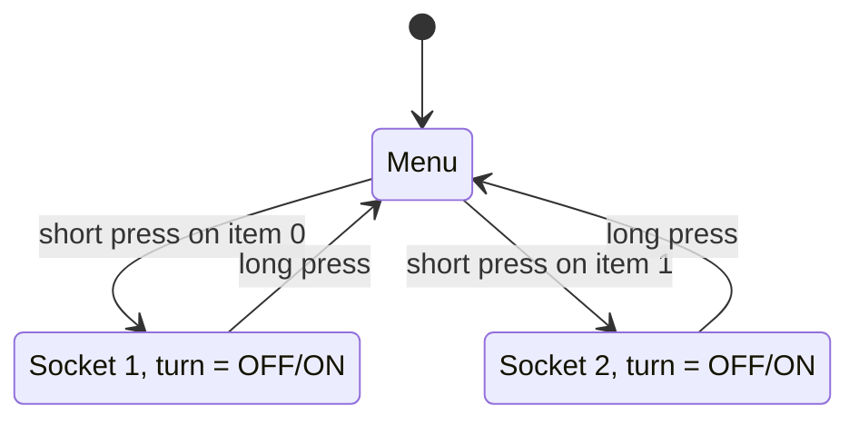
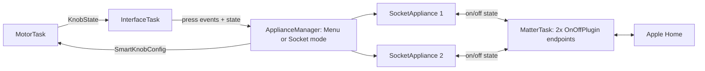

# Matter-over-WiFi for SmartKnob (HomeKit): menu + 2 sockets (v3)

## Goal Description
The SmartKnob becomes a Matter accessory over WiFi for Apple Home. First version: **two sockets** (Socket 1, Socket 2), built modularly so more appliance types can be added later.

Knob behaviour:
1. **Main menu:** turn to choose Socket 1 or Socket 2 (two detents). A **short press** confirms.
2. **Socket mode:** turn to switch the socket **OFF (position 0) or ON (position 1)**. This uses the existing "On/off, strong detent" config (`configs[3]` in [interface_task.cpp](file:///Users/marcel/Desktop/SmartKnob/smartknob/firmware/src/interface_task.cpp)): bounded 0–1 with a strong detent, so the two positions are the two end stops.
3. **Long press** (hold about 1.5 s) returns to the main menu. It fires **as soon as the threshold is reached, while the button is still held**, with no need to release.

The USB-serial protobuf interface stays working.

## What I found in the code
- Press detection is **strain-gauge based** (`SK_STRAIN`, needs the HX711 calibration done once). Today a press immediately calls `changeConfig(true)`, which cycles through the demo configs. It has **no long-press detection**. I'll add a hold timer and replace the cycling in Matter builds.
- [display_task.cpp](file:///Users/marcel/Desktop/SmartKnob/smartknob/firmware/src/display_task.cpp) draws whatever `config.text`, position and min/max say (value number, fill bar, dot on the arc). So the menu and the socket screens can **reuse the existing renderer**, with no new UI code needed. A small optional tweak shows "ON/OFF" instead of 0/1.
- Config is applied through `applyConfig()`. A `position_nonce` change forces the knob to a given position, which I use when entering a socket (so the knob starts at the socket's current state) and when HomeKit changes the state remotely.

## Decisions
| Topic | Decision |
|---|---|
| Hardware | 8 MB flash, 2 MB PSRAM, original ESP32 (ESP32-PICO-V3-02) |
| Stack | Arduino-ESP32 3.x Matter library (via pioarduino) |
| Partitions | Keep OTA: two ~2.75 MB app slots, NVS, small FAT |
| PSRAM | Checked at boot in Phase 0. If it's fast enough, the display sprite moves there; otherwise a smaller sprite |
| Appliances | 2 sockets now, via an `Appliance` interface so you can add types later |

## User Review Required
> [!IMPORTANT]
> **Matter device type (confirmed: Outlet).** Before, we planned "stateless switch" (events only). For sockets with a real ON/OFF state, the better fit is the Matter **On/Off Plug-in Unit**. HomeKit then shows them as **Outlets**. Advantages: the state is **two-way**. Turning the knob switches the outlet in the Home app, and toggling it in the Home app or through Siri moves the knob to the new position. The downside: an outlet has no effect by itself, so you link it to something in HomeKit (a scene or automation that controls another accessory). If you'd rather have pure button events, tell me and I'll use `MatterGenericSwitch` instead.

> [!WARNING]
> **Platform upgrade is the biggest risk.** Matter needs Arduino core 3.x, so the build moves from `espressif32@3.4` to pioarduino. Pinned libraries (SimpleFOC 2.2.0, TFT_eSPI, FastLED, HX711) and `ledc`/timer code may need fixes, and the motor feel must be re-verified. The old `view` env stays as a fallback. A feasibility spike (Phase 0) checks heap and PSRAM first.

> [!NOTE]
> Matter endpoints are created at boot, so adding a new appliance means re-flashing. Pairing uses the library's test credentials (not certified, fine for personal use). Apple Home automations need a Home Hub (HomePod or Apple TV).

## Decisions confirmed
- **Outlet** (On/Off plug-in unit, two-way state).
- **Long press** at 1.5 s, triggered while held. Short press registers on release. The threshold is a single constant (`LONG_PRESS_MS`) that is easy to tune.
- Display shows **ON/OFF** instead of 0/1.

## Architecture





The appliance interface (small and extendable):

```cpp
// firmware/src/appliances/appliance.h
class Appliance {
 public:
  virtual ~Appliance() = default;
  virtual const char* name() const = 0;               // menu label and HomeKit name
  virtual PB_SmartKnobConfig knobConfig(int32_t startPosition) const = 0;
  virtual void onPositionChanged(int32_t pos) = 0;    // e.g. publish to Matter
  virtual void setRemoteState(bool on) = 0;           // from HomeKit
};
// Registry: Appliance* const kAppliances[] = { &socket1, &socket2 };
```

## Proposed Changes

### Build system
#### [MODIFY] platformio.ini
New `[env:view_matter]` extending `view`, with pioarduino (core 3.x), `board_upload.flash_size = 8MB`, `-DSK_MATTER=1`, and `-DBOARD_HAS_PSRAM` if Phase 0 confirms. `view` stays as is.
#### [NEW] firmware/partitions-matter-8MB.csv
NVS about 64 KB, otadata, `ota_0` and `ota_1` of about 2.75 MB each, and about 1 MB FAT.

### Appliance module
#### [NEW] firmware/src/appliances/appliance.h, registry.h/.cpp
Interface and registry above.
#### [NEW] firmware/src/appliances/socket_appliance.h/.cpp
Knob config derived from `configs[3]`: min 0, max 1, 60° per position, detent strength 1, snap point 0.55, text "Socket N" and a distinct LED hue per socket. On/off state is stored persistently.
#### [NEW] firmware/src/appliances/appliance_manager.h/.cpp
State machine (Menu or Socket mode). It builds the menu config on the fly (min 0, max N−1, detents on, text lists the item name). On a short press in the menu it enters the appliance, applying its config with a new `position_nonce`. On a long press it goes back to the menu.

### Input
#### [MODIFY] firmware/src/interface_task.cpp / .h
- Add press timing in `updateHardware()`: record the press start. If the press is still held at **1.5 s**, fire the long press once, immediately, with haptic feedback (no release needed), and ignore the following release. If the knob is released before 1.5 s, it counts as a short press on release.
- In `SK_MATTER` builds, replace `changeConfig(true)` on press with calls to `ApplianceManager::onShortPress()` / `onLongPress()`.
- Forward position changes from `knob_state_queue_` to `ApplianceManager`.
- Serial behaviour is unchanged for non-Matter builds, and `configs[]` stays.

### Matter
#### [NEW] firmware/src/matter_task.h/.cpp
`Task<MatterTask>` under `#if SK_MATTER` on core 0 (the motor stays on core 1). It starts WiFi/Matter, creates one `MatterOnOffPlugin` per registry entry, and forwards changes both ways through non-blocking queues: knob to Matter, and Matter callback to `setRemoteState()`, which re-applies the knob position. BLE commissioning provides the WiFi credentials (no hardcoded SSID). A 10 s hold on the pairing screen factory-resets via `Matter.decommission()`.
#### [MODIFY] firmware/src/main.cpp
Construct and start `MatterTask`/`ApplianceManager` under `#if SK_MATTER`.

### Display
#### [MODIFY] firmware/src/display_task.cpp
Small tweak: show "ON"/"OFF" for socket configs and a pairing screen (setup code) until commissioned. The menu itself needs no change.

### Persistence
#### [MODIFY] proto/smartknob.proto, configuration.cpp
Store socket on/off states (and nothing else) in `PB_PersistentConfiguration`, then regenerate nanopb via the existing script.

### Docs
#### [MODIFY] README.md
Matter section: build env, pairing, reset, adding an appliance.

## Phases
0. **Feasibility spike:** PSRAM present?, free heap with display + WiFi + Matter on the 8 MB board. Go/no-go.
1. **Platform migration** (pioarduino), no Matter. The motor, display, LEDs and serial must be unchanged.
2. **Menu + sockets on the knob** (no Matter yet): short/long press, config switching, persistence. Testable on the device and over serial logs.
3. **Matter:** two outlet endpoints, pairing, two-way sync.
4. **Polish:** pairing screen, ON/OFF label, reset flow, docs, 24 h soak.

## Verification Plan
### Automated Tests
- `pio run -e view` (regression) and `pio run -e view_matter` (builds, fits the 2.75 MB slot).
- Native unit tests for `ApplianceManager` (pure logic: press events and positions in, configs and state out): `pio test -e native`. Covers menu → socket → long press → menu, plus remote state changes.
- Runtime heap log, with free heap above 30 KB over 10 minutes.

### Manual Verification
- Menu shows Socket 1 / Socket 2, and a short press enters the socket.
- Turning flips between OFF and ON with a clear detent. A long press returns to the menu.
- Pair in Apple Home and see two Outlets. Knob changes show up in Home, and toggling in Home moves the knob.
- Settings survive a reboot. No motor stutter while WiFi runs. The serial apps still work. OTA works.
